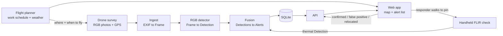

# System Architecture: What About the Turtles

**Status:** v1 draft, Oct 13, 2026. Owner: Naz. **Read it and raise objections by Fri Oct 16.** After that, the contracts in section 4 are frozen and changes need everyone's OK.

Each person also has a starter brief in their own folder:
- Jake: [`turtles/detection/README.md`](../detection/README.md)
- Ethan: [`turtles/backend/README.md`](../backend/README.md)
- Huy: [`turtles/ui_docs/README.md`](../ui_docs/README.md)

---

## 0. Read this first: the thermal camera does not go on the drone

The earlier plan clamped a FLIR One onto the DJI Mini 4 Pro. That doesn't work, for three reasons:

| Problem | Numbers |
|---|---|
| Too heavy | The FLIR One Edge Pro weighs **153 g**. The whole Mini 4 Pro is **under 249 g**. Adding about 60% of its weight is not a safe flight. DJI warns that added weight reduces propulsion. |
| Too short a link | The Edge Pro talks to its phone over Wi-Fi with a range of **about 5 m**. The plug-in FLIR One Pro needs the phone attached, which is even heavier. |
| Too low resolution from the air | The thermal sensor is **160 × 120 px**. At 15 m up, each pixel covers about 9.6 cm of ground, so a box turtle shows up as **1–2 pixels**. At 1.5 m (handheld), it's about 14 px, which is usable. |

**New design:** a two-stage search.

1. **Find (aerial, RGB):** the drone photographs the site from straight above. The RGB model flags likely turtles with GPS coordinates.
2. **Confirm (ground, thermal + eyes):** a responder walks to each flagged pin with the FLIR One on their phone. A thermal hit near the pin upgrades the alert to high confidence, and the responder marks it confirmed, relocated, or a false positive.

This is how thermal was actually validated (handheld, close range). It also keeps the fusion idea of two sensors agreeing. And every responder verdict becomes a labeled example for retraining.

**Hardware change:** don't buy a clamp mount. Buy one FLIR One for handheld use; the cheaper plug-in FLIR One Pro is fine for this.

> **Update (Oct 13): Plan A, pending Logan.** We may instead rent a **DJI Mavic 3 Thermal**, which has both a 48 MP regular camera and a 640×512 thermal camera built in. That puts thermal in the air for real: at 8–10 m, a turtle shows up as a hot spot of about 9 pixels, captured at the same moment and GPS position as the regular photo.
>
> **None of the contracts change either way.** Aerial thermal frames are just `sensor: "thermal"` frames with an altitude, and fusion already treats regular-plus-thermal agreement as high confidence. If Plan A happens, only this section, the capture spec (section 7), and Jake's thermal reader (DJI thermal JPEGs instead of FLIR) change. The handheld design above is Plan B.

---

## 1. How it works end to end



**Processing happens after landing, not live.** Logan flies, lands, and the photos are uploaded and processed in a few minutes. Live streaming from a DJI Mini into custom software is a big, risky integration and isn't needed. The turtles aren't going anywhere fast.

**The pipeline doesn't care which drone took the photos.** Anything that writes GPS and altitude into its photos works, including W.A. Hazel's own survey drones. That supports Tanya's ask that the system scale across companies and sites.

---

## 2. Components and owners

| Component | Owner | Code | Input | Output |
|---|---|---|---|---|
| Flight + capture spec, contracts, integration | Naz | `turtles/contracts.py`, `turtles/geo.py`, this doc | - | - |
| **Flight planner**: where and when to survey | Naz | `turtles/planner/` ([brief](../planner/README.md)) | `Zone`s + weather forecast + Tanya's activity rules | `list[FlightWindow]` |
| *Stretch:* turtle-likelihood heat map + "couldn't see here" coverage map | Naz | `turtles/planner/` | free NAIP NDVI imagery, haul roads/edges, our alerts, survey photos | GeoJSON layers |
| Flying the drone | Logan (W.A. Hazel, Part 107 certified) | - | capture spec (section 7) | folder of photos |
| Ingest | Ethan | `turtles/backend/ingest.py` | photo folder | `list[Frame]` |
| RGB + thermal detection | Jake | `turtles/detection/detector.py` | `Frame` + image | `list[Detection]` |
| Fusion | Ethan (v1 already written) | `turtles/backend/fusion.py` | `list[Detection]` | `list[Alert]` |
| Storage + API | Ethan | `turtles/backend/api.py` (to write) | `Alert`s | JSON over HTTP |
| Web app / dashboard, demo video | Huy | `turtles/ui_docs/` | API JSON (mock JSON until the API is up) | what people see |

---

## 3. Repo layout

```
turtles/
├── contracts.py        shared data shapes: everyone imports these
├── geo.py              pixel -> lat/lon, distances, camera field-of-view values
├── architecture/
│   ├── ARCHITECTURE.md this file
│   └── mock/           frames, detections, alerts, zones, windows (.json): fake but consistent data to build against
├── planner/            Naz: where and when to fly (work schedule + weather)
├── detection/          Jake: detector.py, training, eval
├── backend/            Ethan: ingest.py, fusion.py, api.py
├── ui_docs/            Huy: web app, demo materials
└── data/               real images (never commit them; share through Drive)
tests/
└── test_contracts.py   python3 -m pytest -q
```

Quick check that the mock data still matches the contracts: `python3 -m turtles.contracts`

---

## 4. The contracts

`turtles/contracts.py` is the source of truth. This is a summary. Times are UTC ISO 8601 strings, and coordinates are decimal degrees.

**Frame**: one image plus where and when it was taken.
`frame_id, flight_id, site_id, sensor (rgb|thermal), path, timestamp, lat, lon, alt_m, yaw_deg, width_px, height_px, hfov_deg`

**Detection**: one thing a model thinks is a turtle, in one frame.
`detection_id, frame_id, sensor, bbox [x_min, y_min, x_max, y_max] px, score 0-1, lat, lon, timestamp, model_version`

**Alert**: one probable turtle at one spot. This is what a human acts on.
`alert_id, site_id, flight_id, lat, lon, confidence (high|review), score, sensors [..], detection_ids [..], thumbnail, created_at, status (open|confirmed|false_positive|relocated), note`

Example alert, from `mock/alerts.json`:

```json
{
  "alert_id": "F-20261025-01-A001",
  "site_id": "grayson-mock",
  "flight_id": "F-20261025-01",
  "lat": 38.7601787,
  "lon": -77.5199661,
  "confidence": "high",
  "score": 0.88,
  "sensors": ["rgb", "thermal"],
  "detection_ids": ["F-20261025-01-d004", "F-20261025-01-d003", "F-20261025-01-d008"],
  "thumbnail": "thumbnails/F-20261025-01-d004.jpg",
  "created_at": "2026-10-25T14:22:05Z",
  "status": "relocated",
  "note": "Eastern box turtle, moved to woodline north of lot"
}
```

The mock coordinates are placeholders, not the real Grayson site.

---

## 5. Fusion rules v1

Implemented in `turtles/backend/fusion.py`. Tune the numbers after the first real flight.

1. **Drop weak detections:** RGB below 0.25, thermal below 0.5.
2. **Group detections within 4 m** of each other as one turtle. Photos overlap, so the same turtle often appears in two photos, and drone GPS drifts a meter or two.
3. **Confidence:**
   - **High:** RGB and thermal both fired, **or** RGB saw it in 2 or more different photos at a score of 0.7 or higher.
   - **Review:** everything else.
4. **Alert location** is the score-weighted average of its detections. **Alert score** is the best single detection.
5. Every alert starts as `open`. Only a human changes the status.

---

## 6. API

Ethan builds this; Huy consumes it. Suggested stack: FastAPI + SQLite, run on a laptop for the demo.

| Method | Path | Body | Returns |
|---|---|---|---|
| `POST` | `/flights` | zip of photos + `site_id` | `{flight_id, frames, detections, alerts}` counts |
| `GET` | `/alerts?site_id=&status=` | - | `[Alert]` newest first |
| `GET` | `/alerts/{alert_id}` | - | `Alert` |
| `PATCH` | `/alerts/{alert_id}` | `{"status": "...", "note": "..."}` | updated `Alert` |
| `POST` | `/alerts/{alert_id}/thermal` | thermal image + phone lat/lon | re-fused `Alert` (stretch) |
| `GET` | `/thumbnails/{file}` | - | JPEG crop |
| `GET` | `/plan?site_id=` | - | `[FlightWindow]` best first (calls `turtles.planner.plan`) |
| `GET` | `/zones?site_id=` | - | `[Zone]` for drawing work areas on the map |
| `GET` | `/heatmap?site_id=` | - | GeoJSON `FeatureCollection` of grid cells with `likelihood` 0-1 and `reasons` (stretch; `mock/heatmap.geojson` until ready) |

Until this exists, Huy builds against `mock/alerts.json`. Switching later is a one-line change of base URL.

---

## 7. Capture spec for Logan's flights (DJI Mavic 3 Enterprise, verified Oct 14)

**The drone:** W.A. Hazel's **DJI Mavic 3 Enterprise (M3E)**, flown by Logan. It's already registered to Hazel, so we don't register anything. Verified against real photos from Logan's Sept 29 Grayson flight:
- Wide camera: 5280 × 3956 px, mechanical shutter (no motion blur).
- Calibrated horizontal field of view: **70.65°**.
- Every photo carries GPS, altitude above takeoff, gimbal angles, and exact UTC time (see `turtles/backend/ingest.py` for the tag names).

**Photos, not video:**
- Interval shooting, gimbal at −90° (straight down), steady speed.
- The live HDMI feed is about 1080p, so it's for spotting only (section 1).

**How big a 13 cm box turtle looks in an M3E wide photo:**

| Height | cm per pixel | Turtle | Each photo covers |
|---|---|---|---|
| **50 ft (15 m)** | 0.40 | **~32 px**: ask for this | 21 × 16 m |
| 65 ft (20 m) | 0.54 | ~24 px: upper limit | 28 × 21 m |
| 100 ft (30 m) | 0.81 | ~16 px: too small | 43 × 32 m |
| 180 ft (55 m) | 1.48 | ~9 px | 78 × 58 m |
| 380 ft (116 m) | 3.11 | ~4 px: Logan's mapping height | 164 × 123 m |

Detectors get unreliable below about 20 px. **Target: ~50 ft, 65 ft max.** Logan's normal mapping flights (380 ft, 80% overlap) are great for site maps but can't show turtles.

**Overlap:** 20–30% between photos, so a turtle near a photo edge shows up twice for the multi-view rule (section 5). That's much less than mapping needs, so the flight is quicker.

**Where to fly:** haul roads and site edges first. That's where Tanya finds injured and dead turtles, and where the planner points.

**What the site looks like (Sept 29 photos):**
- Red-brown bare dirt, standing puddles, tire ruts, culvert pipe stacks, and parked equipment.
- A strip of grass and silt fence between the site and Old Carolina Rd.
- Woods at the far edge.
- Train on this kind of ground (section 8).

**Timing:** daylight, ideally right after rain (Tanya's records), 70–80°F. The planner picks the window.

**GPS accuracy:**
- The Sept 29 photos are tagged `RtkFlag=16`: standard GPS, about 1–1.5 m. That's fine, since alerts group detections within 4 m.
- With an RTK fix (`RtkFlag=50`) it would be centimeter-level.
- Logan's flight folder also includes PPK files for centimeter post-processing. We don't need them.

**Handoff:** Logan gives us the SD card folder. It goes to `POST /flights`, or into `turtles/data/flights/<flight_id>/` until the API exists. Never commit photos.

**Privacy:** the photos also show neighbors' houses and cars across Old Carolina Rd. Keep imagery private, and crop to the site in the pitch and demo.

**Before any flight:** everyone on site needs their own PPE and a signed W.A. Hazel waiver. Logan is the Remote Pilot in Command.

---

## 8. Biggest technical risk: the training photos look nothing like drone photos

Most of Tanya's archive is phone photos taken at ground level, from the side. The drone sees a small shell from directly above. A model trained only on the archive may miss turtles in aerial photos.

How we deal with it:

1. **We have Logan's Sept 29 Grayson photos** (380 ft, so no turtles are visible). They show exactly what the background looks like: red-brown dirt, puddles, ruts, pipes, equipment. Make sure the GMU top-down session includes bare brown dirt and mud. After the low flight, those real photos become our best negative examples.
2. **Make aerial-style training photos without a drone.** Hold a phone straight down over a real turtle (for example, at a nature center), then shrink the image so the turtle is 25–60 px, matching section 7. Do the same over rocks, pinecones, and clods of dirt for negatives.
3. **Use the archive anyway.** It still teaches shell color and pattern. Augment it with rotation, scale, and blur.
4. **Measure recall first.** Missing a turtle is the costly mistake, while a false alarm only costs a short walk. Tune thresholds for recall.

---

## 9. Milestones

| Date | Everyone can see… |
|---|---|
| **Fri Oct 16** | Contracts agreed in Discord; nobody is blocked. |
| **Tue Oct 20** | Each piece runs alone on mock data. Jake: `detect()` returns Detections on 20 labeled photos. Ethan: `GET /alerts` serves the mock alerts and `PATCH` saves. Huy: map + list render from `mock/alerts.json`. Naz: the planner ranks forecast hours for the mock zones. |
| **Fri Oct 23** (end of Week 6) | **End to end without a drone:** a folder of photos goes through ingest, detect, fuse, the API, and shows up in the web app. |
| **Weekend, date TBD** with Tanya + Logan | Grayson site flight, **at the time the planner picks**. Run real photos through the system, measure recall, retrain. Note whether thermal matched the planner's prediction. |
| **Fri Oct 30** | Demo freeze. Record a full run on real flight data. |
| **Oct 31 – Nov 7** | Showcase. **Never depend on a live flight on stage.** Replay real flight data through the live system. |

---

## 10. Open decisions

| Question | Who decides / asks |
|---|---|
| Perimeter band or full-site grid? Ask Tanya where turtles get hurt most (edges, clearing zones?). | Naz → Tanya |
| Will Logan fly **our** Mini 4 Pro or W.A. Hazel's own drone? If theirs, we may not need to buy one at all. | Naz → Logan |
| Who carries the handheld FLIR on site: Tanya's responders, site crew, or us? | Naz → Tanya |
| Alerts beyond the web app (SMS/email for high-confidence alerts)? Stretch goal. | Ethan |
| Exact FAA registration steps for the Grayson airspace | Waiting on Logan |
| Rent a DJI Mavic 3 Thermal (Plan A) or go handheld thermal (Plan B)? | Naz → Logan |
| Grayson work schedule: which zones get cleared or graded, and when (planner input) | Naz → Tanya/Logan |
| Turtle activity patterns + past sightings (planner rules) | Naz → Tanya |
