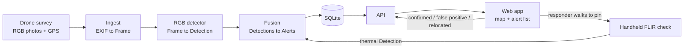

# System Architecture: What About the Turtles

**Status:** v1 draft, Oct 13, 2026. Owner: Naz. **Read it and raise objections by Thu Oct 16.** After that, the contracts in section 4 are frozen and changes need everyone's OK.

Each person also has a starter brief in their own folder:
- Jake: [`turtles/detection/README.md`](../detection/README.md)
- Ethan: [`turtles/backend/README.md`](../backend/README.md)
- Huy: [`turtles/ui_docs/README.md`](../ui_docs/README.md)

---

## 0. Read this first: the thermal camera does not go on the drone

The earlier plan clamped a FLIR One onto the DJI Mini 4 Pro. That doesn't work, for three reasons:

| Problem | Numbers |
|---|---|
| Too heavy | The FLIR One Edge Pro weighs **153 g**. The whole Mini 4 Pro is **under 249 g**. Adding about 60% of its weight is not a safe flight. DJI warns that added weight reduces propulsion. |
| Too short a link | The Edge Pro talks to its phone over Wi-Fi with a range of **about 5 m**. The plug-in FLIR One Pro needs the phone attached, which is even heavier. |
| Too low resolution from the air | The thermal sensor is **160 × 120 px**. At 15 m up, each pixel covers about 9.6 cm of ground, so a box turtle shows up as **1–2 pixels**. At 1.5 m (handheld), it's about 14 px, which is usable. |

**New design:** a two-stage search.

1. **Find (aerial, RGB):** the drone photographs the site from straight above. The RGB model flags likely turtles with GPS coordinates.
2. **Confirm (ground, thermal + eyes):** a responder walks to each flagged pin with the FLIR One on their phone. A thermal hit near the pin upgrades the alert to high confidence, and the responder marks it confirmed, relocated, or a false positive.

This is how thermal was actually validated (handheld, close range). It also keeps the fusion idea of two sensors agreeing. And every responder verdict becomes a labeled example for retraining.

**Hardware change:** don't buy a clamp mount. Buy one FLIR One for handheld use; the cheaper plug-in FLIR One Pro is fine for this.

---

## 1. How it works end to end



**Processing happens after landing, not live.** Logan flies, lands, and the photos are uploaded and processed in a few minutes. Live streaming from a DJI Mini into custom software is a big, risky integration and isn't needed. The turtles aren't going anywhere fast.

**The pipeline doesn't care which drone took the photos.** Anything that writes GPS and altitude into its photos works, including W.A. Hazel's own survey drones. That supports Tanya's ask that the system scale across companies and sites.

---

## 2. Components and owners

| Component | Owner | Code | Input | Output |
|---|---|---|---|---|
| Flight + capture spec, contracts, integration | Naz | `turtles/contracts.py`, `turtles/geo.py`, this doc | - | - |
| Flying the drone | Logan (W.A. Hazel, Part 107 certified) | - | capture spec (section 7) | folder of photos |
| Ingest | Ethan | `turtles/backend/ingest.py` | photo folder | `list[Frame]` |
| RGB + thermal detection | Jake | `turtles/detection/detector.py` | `Frame` + image | `list[Detection]` |
| Fusion | Ethan (v1 already written) | `turtles/backend/fusion.py` | `list[Detection]` | `list[Alert]` |
| Storage + API | Ethan | `turtles/backend/api.py` (to write) | `Alert`s | JSON over HTTP |
| Web app / dashboard, demo video | Huy | `turtles/ui_docs/` | API JSON (mock JSON until the API is up) | what people see |

---

## 3. Repo layout

```
turtles/
├── contracts.py        shared data shapes: everyone imports these
├── geo.py              pixel -> lat/lon, distances, camera field-of-view values
├── architecture/
│   ├── ARCHITECTURE.md this file
│   └── mock/           frames.json, detections.json, alerts.json: fake but consistent data to build against
├── detection/          Jake: detector.py, training, eval
├── backend/            Ethan: ingest.py, fusion.py, api.py
├── ui_docs/            Huy: web app, demo materials
└── data/               real images (never commit them; share through Drive)
tests/
└── test_contracts.py   python3 -m pytest -q
```

Quick check that the mock data still matches the contracts: `python3 -m turtles.contracts`

---

## 4. The contracts

`turtles/contracts.py` is the source of truth. This is a summary. Times are UTC ISO 8601 strings, and coordinates are decimal degrees.

**Frame**: one image plus where and when it was taken.
`frame_id, flight_id, site_id, sensor (rgb|thermal), path, timestamp, lat, lon, alt_m, yaw_deg, width_px, height_px, hfov_deg`

**Detection**: one thing a model thinks is a turtle, in one frame.
`detection_id, frame_id, sensor, bbox [x_min, y_min, x_max, y_max] px, score 0-1, lat, lon, timestamp, model_version`

**Alert**: one probable turtle at one spot. This is what a human acts on.
`alert_id, site_id, flight_id, lat, lon, confidence (high|review), score, sensors [..], detection_ids [..], thumbnail, created_at, status (open|confirmed|false_positive|relocated), note`

Example alert, from `mock/alerts.json`:

```json
{
  "alert_id": "F-20261025-01-A001",
  "site_id": "grayson-mock",
  "flight_id": "F-20261025-01",
  "lat": 38.7601774,
  "lon": -77.5199648,
  "confidence": "high",
  "score": 0.88,
  "sensors": ["rgb", "thermal"],
  "detection_ids": ["F-20261025-01-d004", "F-20261025-01-d003", "F-20261025-01-d008"],
  "thumbnail": "thumbnails/F-20261025-01-d004.jpg",
  "created_at": "2026-10-25T14:22:05Z",
  "status": "relocated",
  "note": "Eastern box turtle, moved to woodline north of lot"
}
```

The mock coordinates are placeholders, not the real Grayson site.

---

## 5. Fusion rules v1

Implemented in `turtles/backend/fusion.py`. Tune the numbers after the first real flight.

1. **Drop weak detections:** RGB below 0.25, thermal below 0.5.
2. **Group detections within 4 m** of each other as one turtle. Photos overlap, so the same turtle often appears in two photos, and drone GPS drifts a meter or two.
3. **Confidence:**
   - **High:** RGB and thermal both fired, **or** RGB saw it in 2 or more different photos at a score of 0.7 or higher.
   - **Review:** everything else.
4. **Alert location** is the score-weighted average of its detections. **Alert score** is the best single detection.
5. Every alert starts as `open`. Only a human changes the status.

---

## 6. API

Ethan builds this; Huy consumes it. Suggested stack: FastAPI + SQLite, run on a laptop for the demo.

| Method | Path | Body | Returns |
|---|---|---|---|
| `POST` | `/flights` | zip of photos + `site_id` | `{flight_id, frames, detections, alerts}` counts |
| `GET` | `/alerts?site_id=&status=` | - | `[Alert]` newest first |
| `GET` | `/alerts/{alert_id}` | - | `Alert` |
| `PATCH` | `/alerts/{alert_id}` | `{"status": "...", "note": "..."}` | updated `Alert` |
| `POST` | `/alerts/{alert_id}/thermal` | thermal image + phone lat/lon | re-fused `Alert` (stretch) |
| `GET` | `/thumbnails/{file}` | - | JPEG crop |

Until this exists, Huy builds against `mock/alerts.json`. Switching later is a one-line change of base URL.

---

## 7. Capture spec for Logan's flights

**Photos, not video:**
- Interval shooting, gimbal at −90° (straight down), steady speed.
- Each DJI photo carries its own GPS, altitude, and heading, so ingest is easy.
- Photos have far more pixels than video frames.

**How big a turtle looks:** pixels across a ~13 cm box turtle, calculated from the spec field of view. Verify on the first flight.

| Height | 48 MP photo | 12 MP photo | 4K video frame |
|---|---|---|---|
| 10 m | 75 px | 38 px | 33 px |
| **15 m** | **50 px** | 25 px | 22 px |
| 20 m | 38 px | 19 px | 16 px |
| 30 m | 25 px | 13 px | 11 px |

Detectors get unreliable below about 20 px. **Target: 48 MP photos at 15 m.** If 48 MP interval shooting is too slow, use 12 MP at 10–12 m.

**Overlap:** at least 20% between photos, so a turtle near a photo edge shows up twice. That's what the multi-view rule in section 5 relies on.

**Coverage at 15 m:** each photo covers about 21 × 16 m.
- **Perimeter band** (1 mile, one lane): about 130 photos. Quick.
- **Full 40-acre grid:** about 770 photos, likely 1–2 batteries.
- Which one to fly is an open question (section 10).

**Timing:**
- RGB works in any daylight; overcast is fine and avoids harsh shadows.
- Do the handheld thermal checks when turtles read warm against the ground: after they've basked, or early morning or evening as the ground cools (from our Oct 13 validation).

**Handoff:** Logan gives us the SD card folder. It goes to `POST /flights`, or into `turtles/data/flights/<flight_id>/` until the API exists.

**Before any flight:** the drone must be FAA-registered (waiting on Logan's details), and everyone on site needs their own PPE.

---

## 8. Biggest technical risk: the training photos look nothing like drone photos

Most of Tanya's archive is phone photos taken at ground level, from the side. The drone sees a small shell from directly above. A model trained only on the archive may miss turtles in aerial photos.

How we deal with it:

1. **Ask Logan now for any existing aerial photos of W.A. Hazel sites**, even without turtles. They're perfect negative examples: dirt, debris, and equipment the model must learn to ignore.
2. **Make aerial-style training photos without a drone.** Hold a phone straight down over a real turtle (for example, at a nature center), then shrink the image so the turtle is 25–60 px, matching section 7. Do the same over rocks, pinecones, and clods of dirt for negatives.
3. **Use the archive anyway.** It still teaches shell color and pattern. Augment it with rotation, scale, and blur.
4. **Measure recall first.** Missing a turtle is the costly mistake, while a false alarm only costs a short walk. Tune thresholds for recall.

---

## 9. Milestones

| Date | Everyone can see… |
|---|---|
| **Thu Oct 16** | Contracts agreed in Discord; nobody is blocked. |
| **Mon Oct 20** | Each piece runs alone on mock data. Jake: `detect()` returns Detections on 20 labeled photos. Ethan: `GET /alerts` serves the mock alerts and `PATCH` saves. Huy: map + list render from `mock/alerts.json`. |
| **Fri Oct 23** (end of Week 6) | **End to end without a drone:** a folder of photos goes through ingest, detect, fuse, the API, and shows up in the web app. |
| **Weekend, date TBD** with Tanya + Logan | Grayson site flight. Run real photos through the system, measure recall, retrain. |
| **Thu Oct 30** | Demo freeze. Record a full run on real flight data. |
| **Oct 31 – Nov 7** | Showcase. **Never depend on a live flight on stage.** Replay real flight data through the live system. |

---

## 10. Open decisions

| Question | Who decides / asks |
|---|---|
| Perimeter band or full-site grid? Ask Tanya where turtles get hurt most (edges, clearing zones?). | Naz → Tanya |
| Will Logan fly **our** Mini 4 Pro or W.A. Hazel's own drone? If theirs, we may not need to buy one at all. | Naz → Logan |
| Who carries the handheld FLIR on site: Tanya's responders, site crew, or us? | Naz → Tanya |
| Alerts beyond the web app (SMS/email for high-confidence alerts)? Stretch goal. | Ethan |
| Exact FAA registration steps for the Grayson airspace | Waiting on Logan |
